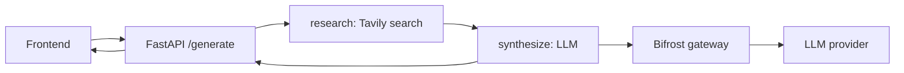
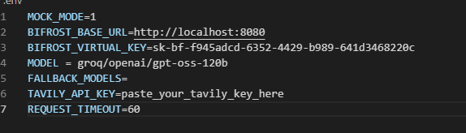
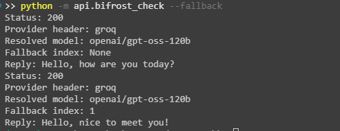

# Pre-Meeting Briefing Agent (PS-05)

Team **Syntax Dynasty** · Global AI Hackathon 2026

Give it a company or person and a meeting time. It builds a one-page briefing of the last 30 days: key developments, talking points, risks and questions, with a source link for every claim and a Verified/Uncertain tag.

## Architecture



## Setup in 5 steps

1. Clone: `git clone https://github.com/Hak-36/syntax-dynasty-pbb.git` then `cd syntax-dynasty-pbb`
2. Create the environment: `python -m venv .venv`, then activate it (`source .venv/Scripts/activate` in Git Bash, or `.venv\Scripts\Activate.ps1` in PowerShell)
3. Install: `pip install -r requirements.txt`
4. Copy `.env.example` to `.env` and fill in your values (see the table below)
5. Run: `uvicorn api.main:app --reload`, then open http://127.0.0.1:8000

## How to use

1. Start the API (step 5 above). With `MOCK_MODE=1` it works with fake data and needs no keys.
2. For real AI calls, start Bifrost in another terminal (`npx -y @maximhq/bifrost`), set `BIFROST_SETUP_TOKEN` first if the dashboard asks for it, add a provider key, and create a virtual key at http://localhost:8080.
3. Put the virtual key in `.env` as `BIFROST_VIRTUAL_KEY` and set `MOCK_MODE=0`.
4. Open http://127.0.0.1:8000, enter a company or person, a meeting time and a meeting type, and read the briefing.
5. Or try the API directly at http://127.0.0.1:8000/docs.

## Environment variables

| Variable | Meaning | Example |
|---|---|---|
| `MOCK_MODE` | `1` = fake data, no keys needed | `1` |
| `TAVILY_API_KEY` | Tavily search key | `your_tavily_key_here` |
| `BIFROST_BASE_URL` | Where Bifrost runs | `http://localhost:8080` |
| `BIFROST_VIRTUAL_KEY` | Bifrost virtual key, sent as `x-bf-vk` | `your_bifrost_virtual_key_here` |
| `PRIMARY_MODEL` | Main model, `provider/model` | `groq/openai/gpt-oss-120b` |
| `FALLBACK_MODELS` | Backup models, comma-separated | (empty) |
| `REQUEST_TIMEOUT` | Seconds before giving up | `60` |

## API reference

**GET /health** returns `{"status": "ok", "mock_mode": true}`

**POST /generate**

Request:
```json
{"name": "Stripe", "entity_type": "company",
 "meeting_time": "2026-11-20T15:00:00Z", "meeting_type": "sales"}
```
`entity_type`: `company` or `person`. `meeting_type`: `sales`, `investor`, `partnership`, `interview`, `general`.

Response: `entity`, `meeting`, `snapshot`, `key_developments` (each with `confidence` and `source_ids`), `talking_points`, `risks`, `questions`, `sources`, `meta`. Errors look like `{"error": {"status": 400, "message": "..."}}`.

## How we use Tavily

_TODO (researcher): queries we run, the 30-day date window, how undated pages are marked Uncertain._

## How we use Bifrost

Every LLM call goes through [Bifrost](https://github.com/maximhq/bifrost), Maxim AI's open-source AI gateway. Our code never talks to a model provider directly, and the provider key lives only inside Bifrost.

- Our API sends OpenAI-style requests to `POST {BIFROST_BASE_URL}/v1/chat/completions` (see `api/bifrost_client.py`).
- Each request carries a Bifrost **virtual key** in the `x-bf-vk` header.
- Models are named `provider/model`, for example `groq/openai/gpt-oss-120b`.
- If the primary model fails, Bifrost retries the models in `fallbacks` (set through `FALLBACK_MODELS`).
- Response headers (`x-bifrost-provider`, `x-bifrost-resolved-model`, `x-bifrost-fallback-index`) show which model answered, and we copy them into `meta` in every briefing.

Check it yourself:
```bash
python -m api.bifrost_check              # normal call
python -m api.bifrost_check --fallback   # fake primary model, Bifrost falls back
```

| Run | Result |
|---|---|
| Normal call | `200`, `Fallback index: None` |
| Fake primary model | `200`, `Fallback index: 1` (the fallback model answered) |




Why a gateway: one API for many models, automatic fallback when a model fails, and a log of every request with latency and token counts.

## Limitations

- Results depend on what Tavily can find; undated pages are marked Uncertain.
- Cache and logs are in memory and reset when the server restarts.
- Prototype only: no login, no rate limiting.

## Team

| Name | Role |
|---|---|
| (add) | Lead, API / DevOps / Docs |
| (add) | Frontend |
| (add) | Research |
| (add) | AI core |