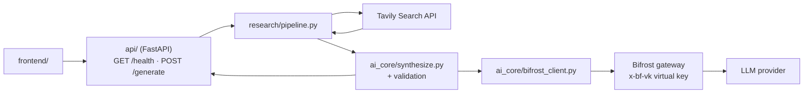

# Pre-Meeting Briefing Agent (PS-05)

Turns a company or person + a meeting time into a one-page, source-linked briefing of the last 30 days. Every development in the briefing is either linked to a retrieved source inside the window, or explicitly flagged as uncertain.

[Repository](https://github.com/Hak-36/syntax-dynasty-pbb) · [Problem statement — PS-05](docs/problem_statement.pdf)

**Tavily** — retrieval layer: category-specific parallel queries, restricted to the 30-day window, with undated results marked `uncertain`.
**Bifrost** — gateway for all LLM calls via virtual key (`x-bf-vk`); Bifrost response headers are surfaced in the API's `meta` field.

---

## Problem

Preparing for a meeting still means scattered search across news, funding announcements, product launches, and leadership changes. Generic AI summaries either miss recent developments or state unsupported claims as fact.

PS-05 asks for: a company or person + a meeting time → a one-page briefing covering the previous 30 days.

This project takes exactly that input and produces a briefing where each development is either linked to a Tavily source inside the window, or explicitly flagged `uncertain`. Confidence is decided by code, not by the model.

---

## Architecture



Every box maps to a directory or file in this repository. `research/` and `ai_core/` are separate modules: retrieval completes and is filtered before any model call is made.

---

## Setup

### Prerequisites

- Python 3.10+ (tested on the latest release)
- Node.js 24 — required for `npx @maximhq/bifrost` in live mode
- A Tavily API key — https://tavily.com
- A Bifrost virtual key — see the Maxim AI Bifrost docs

### 1. Clone and install

```bash
git clone https://github.com/Hak-36/syntax-dynasty-pbb.git
cd syntax-dynasty-pbb
python -m venv .venv
```

Activate the virtual environment:

```bash
# macOS / Linux
source .venv/bin/activate

# Windows — Git Bash
source .venv/Scripts/activate

# Windows — PowerShell
.venv\Scripts\Activate.ps1
```

Install dependencies:

```bash
pip install -r requirements.txt
```

### 2. Start in mock mode (no keys required)

Mock mode returns a deterministic briefing so the API contract and UI can be verified without network access.

```bash
cp .env.example .env
# .env.example defaults to MOCK_MODE=1
uvicorn api.main:app --reload
```

Verify:

```bash
curl http://127.0.0.1:8000/health
# {"status":"ok"}
```

Open http://127.0.0.1:8000 for the UI, or http://127.0.0.1:8000/docs for the OpenAPI schema.

### 3. Start in live mode

Live mode requires the Bifrost gateway running locally, plus the keys below.

```bash
# Terminal 1 — Bifrost gateway
npx -y @maximhq/bifrost

# Terminal 2 — application
uvicorn api.main:app --reload
```

In `.env`:

```dotenv
MOCK_MODE=0
TAVILY_API_KEY=<your-tavily-key>
BIFROST_VIRTUAL_KEY=<your-virtual-key>
```

Verify the gateway is reachable:

```bash
python -m api.bifrost_check
# expect: HTTP 200 and the resolved provider + model in the response headers
```

---

## Usage

Send a request:

```bash
curl -X POST http://127.0.0.1:8000/generate \
  -H "Content-Type: application/json" \
  -d '{
    "name": "Stripe",
    "entity_type": "company",
    "meeting_time": "2026-11-25T15:00:00Z",
    "meeting_type": "sales"
  }'
```

The response contains: `snapshot`, `key_developments`, `talking_points`, `risks`, `questions`, `sources`, and `meta`.

Each item in `key_developments` carries:

- `claim` — the statement shown to the user
- `source_ids` — indices into the `sources` array
- `confidence` — `"verified"` or `"uncertain"`

Each entry in `sources` carries `title`, `url`, `domain`, `published_date` (or `null`), `category`.

`meta` carries the Bifrost response headers: `x-bifrost-provider`, `x-bifrost-resolved-model`, `x-bifrost-fallback-index`.

---

## API reference

### `GET /health`

Returns service liveness.

```json
{ "status": "ok" }
```

### `POST /generate`

**Request body**

| Field | Type | Required | Notes |
|---|---|---|---|
| `name` | string | yes | Company or person |
| `entity_type` | string | yes | `company` or `person` |
| `meeting_time` | ISO 8601 string | yes | Anchor for the 30-day window |
| `meeting_type` | string | no | `sales`, `investor`, `partnership`, `interview`, `general` |

**Error schema**

```json
{ "error": { "status": 400, "message": "..." } }
```

---

## How we use Tavily

All external retrieval runs through the Tavily Search API in `research/pipeline.py`. Retrieval and date filtering complete before any model call is made.

- **Query construction.** Category-specific queries are built from `name`, `entity_type`, and `meeting_type`. 
- **30-day window.** Results are restricted to the 30 days preceding `meeting_time`. 
- **Source attribution.** Every retrieved result is assigned a sequential `source_id` in the `sources` array. Every development item in the briefing cites one or more `source_ids`.
- **Uncertainty tagging.** Results with no `published_date` are retained rather than silently dropped, and marked `"confidence": "uncertain"` by the validation layer. The model does not choose confidence.
- **Failure behavior.** An empty result set or missing API key returns `[]`. The pipeline returns an honest, sparse briefing instead of inventing content.

Tavily is used for search only. This project does not use Tavily extract, crawl, or map endpoints.

---

## How we use Bifrost

All LLM traffic is routed through the Bifrost gateway. The production client lives in `ai_core/bifrost_client.py`. 

- **Authentication:** Requests carry a Bifrost virtual key in the `x-bf-vk` header.
- **Model Routing:** The client passes the primary model (`groq/openai/gpt-oss-120b`) through Bifrost. 
- **Telemetry:** The `x-bifrost-provider`, `x-bifrost-resolved-model`, and `x-bifrost-fallback-index` headers returned by the gateway are copied into the `meta` field of every briefing.
- **Fallback Verification:** The script `api/bifrost_check.py` provides a reproducible test of Bifrost's automatic fallback. By intentionally requesting a non-existent primary model, it forces Bifrost to route to a backup model. 

You can verify the Bifrost fallback mechanism end-to-end:

```bash
python -m api.bifrost_check --fallback
```

Expected output includes `200 OK` and a `Fallback index: 1`.

---

## Trust layer

The synthesis step is constrained, not trusted.

1. The model receives the numbered source list and is instructed to cite `source_ids` for every development item.
2. The validation layer in `ai_core/synthesize.py` checks each item:
   - cites a valid source inside the window → `verified`
   - cites a source with no publication date → `uncertain`
   - cites nothing, or an invalid index → the item is dropped
3. Only the validated set reaches the response.

Confidence is a property of the code path, not a self-assessment by the model.

---

## AI Usage Disclosure

In compliance with Rule 2 of the Global AI Hackathon, AI is used as follows:

- **LLM synthesis.** `groq/openai/gpt-oss-120b` (routed through Bifrost) synthesizes retrieved sources into the structured briefing, talking points, risks, and open questions. The model is used for generation only, never for source selection or confidence assignment.
- **Tavily.** Sole source of web research and retrieval. See [How we use Tavily](#how-we-use-tavily).
- **Bifrost.** Gateway for all model traffic, virtual-key isolation, and provider resolution. See [How we use Bifrost](#how-we-use-bifrost).
- **AI coding assistants.** None.

---

## Build timeline

Core application code in `api/`, `ai_core/`, `research/`, and `frontend/` was authored by Team Syntax Dynasty during the Global AI Hackathon build period. The submission deadline was extended by the organizers to **21 November 2026**, and all commits in this repository fall within the official build period.

Commit history: https://github.com/Hak-36/syntax-dynasty-pbb/commits/main

---

## Limitations

This is a hackathon prototype, not a production service. Current boundaries:

- **In-memory state.** Cache and request logs live in memory and reset on restart. No persistent storage.
- **No authentication or rate limiting.** Single-user, local deployment only.
- **Retrieval-dependent output.** Briefing quality is bounded by what Tavily returns. Paywalled, non-English, and poorly indexed sources are covered unevenly.
- **Undated sources are flagged, not verified.** A result with no `published_date` is marked `uncertain` and shown with that label. It is not silently promoted.
- **No benchmark.** Grounding is enforced structurally through source IDs and the validation layer. Precision, recall, and hallucination rate have not been measured against a labelled dataset.

---

## Team

This repository is the sole submission for **Team Syntax Dynasty**. Each member participates in only this team.

| Name | Role | Modules |
|---|---|---|
| Are Sri Vyshnavi Reddy | API / DevOps | `api/`, `README.md` |
| Chilakapati Hema Yagnasri  | Frontend | `frontend/` |
| Degala Pallavi | Research / Tavily | `research/` |
| Varada Himanish | AI core / Lead | `ai_core/`,Bifrost setup |

---

## License

MIT License — see the [LICENSE](LICENSE) file.

Tavily and Maxim AI Bifrost are used under their respective Terms of Service. No source code from either is redistributed in this repository.
